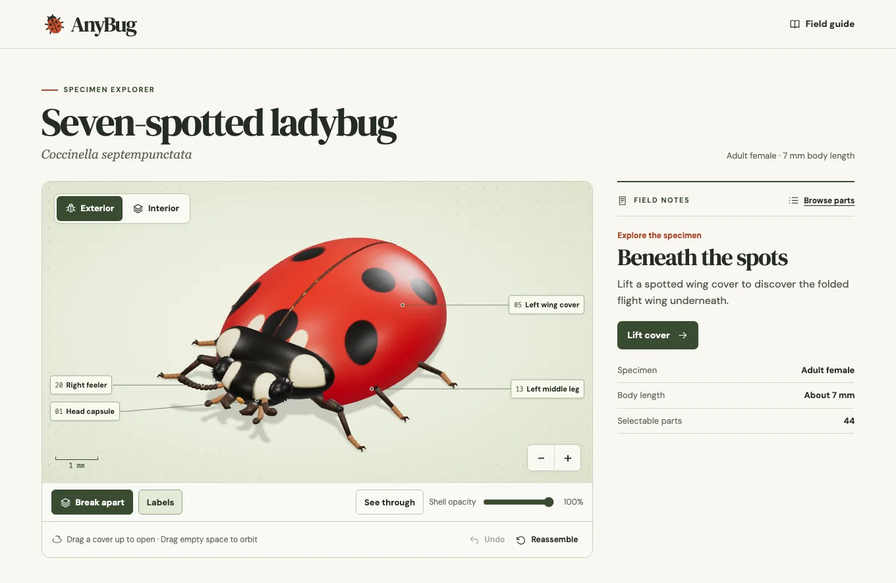
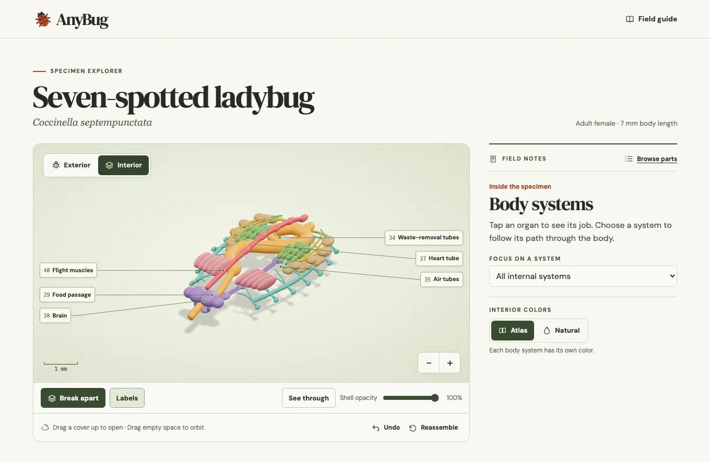

# AnyBug

Explore a bug from the outside in. The first specimen is a seven-spotted ladybug with 44 selectable structures, working wing covers, folding flight wings, and eight internal body systems.



## Open the viewer

From the repository root, run:

```sh
python3 serve.py
```

Open **http://127.0.0.1:4179/** in a browser with WebGL 2. Python 3.9+ is sufficient for viewing. The ready-built specimen, scripts, fonts, and rendering library are included. Everything loads locally.

For a phone or tablet on the same trusted Wi-Fi, run `python3 serve.py --lan` and open `http://<computer-local-IP>:4179/` on that device. The server serves viewer assets only. Use `--port` to choose a different port.

## Explore the ladybug

Drag a spotted wing cover upward and release it halfway open. Reverse the drag to close it. The folded flight wing has its own control. Drag a leg, a mouthpart, or an exposed organ to pull it away. Drag the background to orbit, or pinch to zoom. Tapping a part opens its field note.

**Break apart** spreads the 44 structures and opens the illustrated anatomy key. Each entry has a common name and an anatomical term. Select an entry to find the corresponding part on the 3D model. **Labels** toggles the on-model callouts. Use the arrows underneath the specimen to browse four labels at a time. [View the illustrated anatomy key](docs/ladybug-dissection.webp)

**See through** makes the exterior translucent. Use the shell-opacity slider to uncover the interior gradually, then tap an organ through the faded shell.

Choose **Interior** to expose the organs. Follow one system, pull an organ aside, turn it, and switch between **Atlas** and **Natural** while keeping its position. Use **Put back**, **Undo**, or **Reassemble**. The scale bar follows zoom. The specimen notes describe how closely each structure can be reconstructed. [Anatomy and reference notes](specimens/seven-spot/README.md)



## Rebuild or extend

With Blender 5.2 and Python 3.9+ installed:

```sh
python3 rebuild.py seven-spot
```

For a new species, an author or coding agent first uses references to write the anatomy brief and Blender builder. This command regenerates an authored specimen.

The pipeline writes the editable Blender master, animated GLB, and anatomy manifest, then verifies the GLB in a new Blender process before installing the outputs. Set `BLENDER` to an executable if it is outside your PATH. The shared viewer reads the species catalog. [Add a species](docs/ADDING-A-SPECIES.md) · [Verification](tests/README.md)

Photo identification and matching a family observation to a supported specimen are planned for a later release.

## License

AnyBug code, original models, textures, animations, and educational material use the MIT license. Credits include the AnyMachine workflow inspiration and the licenses for the bundled viewer dependencies. [MIT license](LICENSE) · [Asset sources and credits](ASSETS.md)
